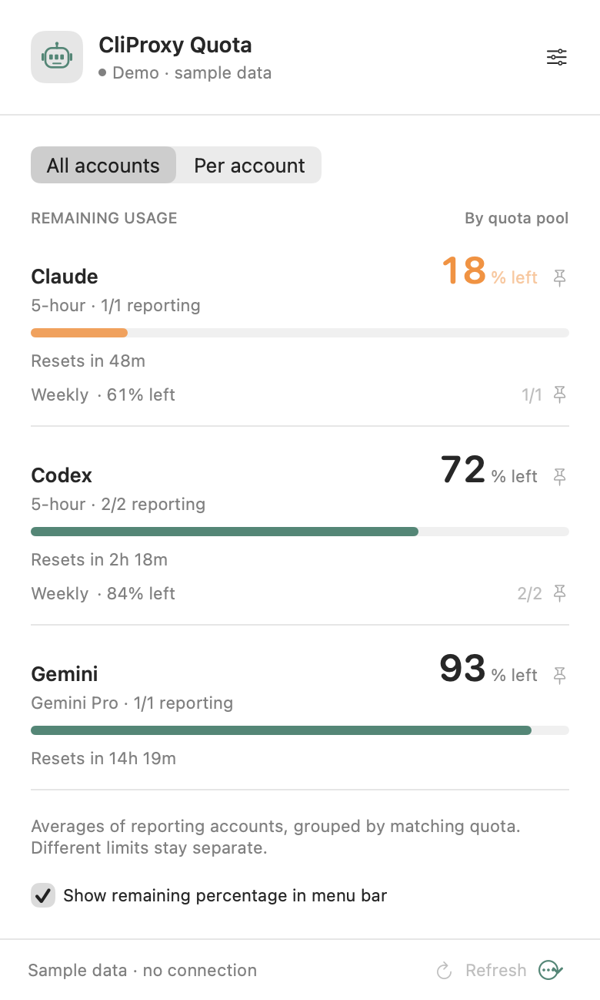
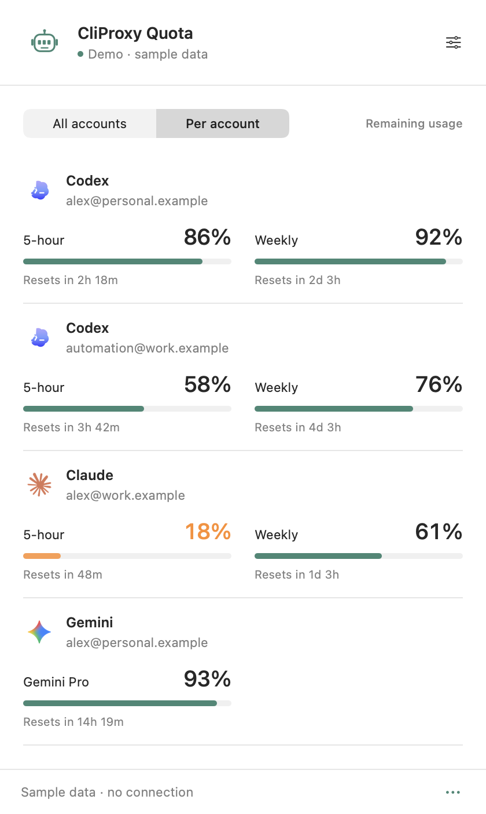
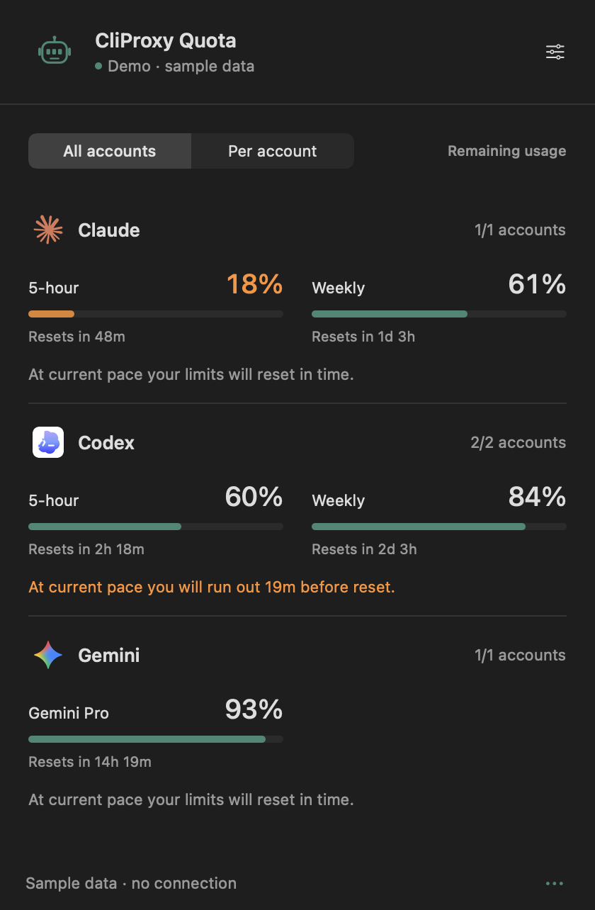
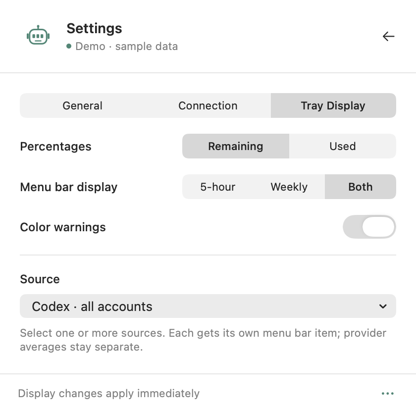

<div align="center">

# CliProxy Quota

**Your remaining AI usage. One glance at the menu bar.**

A small, native macOS app for [CLIProxyAPI](https://github.com/router-for-me/CLIProxyAPI). See remaining subscription quotas, account-level limits, and reset countdowns without opening a browser.




</div>

## A quieter way to watch your limits

- **Remaining usage**, with progress bars and reset countdowns for every reported limit.
- **All accounts** groups matching provider quotas and shows the average remaining percentage.
- **Per account** expands into individual windows, including weekly and model-specific limits.
- **Pin a quota** to show its remaining percentage directly in the menu bar.
- **Automatic refresh** every 1, 2, 5, or 10 minutes, plus manual refresh.
- **Configurable connection** with the management password stored in macOS Keychain, scoped to the instance URL.
- **Light and dark mode**, optional launch at login, and no Dock icon.
- **No third-party dependencies**, analytics, or account-token storage.

<table>
<tr>
<td align="center"><strong>Account detail</strong></td>
<td align="center"><strong>Dark mode</strong></td>
</tr>
<tr>
<td></td>
<td></td>
</tr>
</table>

Screenshots are rendered from the app's actual SwiftUI views in **Demo** mode. Account addresses and percentages are synthetic.

## Install

Requires **macOS 14 Sonoma or later**. Supports Apple Silicon and Intel.

**[Download the latest app](https://github.com/aduggleby/CliProxyQuota/releases/latest)**, unzip it, and move **CliProxy Quota.app** into Applications. No Xcode is needed for the prebuilt app.

To build from source, install Xcode 16 or newer (Swift 6), then:

```sh
git clone https://github.com/aduggleby/CliProxyQuota.git
cd CliProxyQuota
./scripts/build-app.sh
./scripts/install.sh
```

The installer copies the app to `~/Applications` and opens it. You can also copy `build/CliProxy Quota.app` into `/Applications`. Quit the running app before installing an update.

Build for both Apple Silicon and Intel with:

```sh
./scripts/build-app.sh --universal
```

Local builds are **ad-hoc signed**, not Developer ID signed or notarized. Downloaded builds may require **right-click → Open** or approval in **System Settings → Privacy & Security**. Building locally avoids downloading an unsigned executable. Ad-hoc signing can cause Keychain access prompts after rebuilding the app.

## Connect your instance

1. Click the battery icon in the menu bar, then the settings icon.
2. Enter your CLIProxyAPI instance's base URL, such as `http://localhost:8317` or `https://proxy.example.com`.
3. Enter the **management password/key**, not a proxy inference API key or a provider OAuth token.
4. Choose a refresh interval and click **Save & connect**.
5. Use **Per account** to inspect windows; click a pin to put that quota in the menu bar.

The management API must be enabled. Connections from another machine require remote management to be allowed on the server. Your Mac must be able to resolve and reach the URL, including any required VPN.

HTTPS is the default for remote instances. To use a trusted HTTP instance, explicitly enable **Allow HTTP for this instance**. HTTP carries the management password without encryption; the opt-in applies only to that saved URL. Redirects are refused so credentials cannot silently move to another endpoint.



## Provider support

| OAuth account | Reported limits |
| --- | --- |
| Codex | 5-hour, weekly/monthly, code review, and additional windows returned by the usage endpoint |
| Claude | 5-hour, weekly, and supported model-specific weekly windows |
| Gemini CLI | Per-model quota buckets returned by Google Code Assist |
| Antigravity | Quota summary groups and their reset windows |
| Other providers | Listed with an explicit unsupported status |

Google accounts need a `project_id` exposed in their CliProxy credential metadata. An account without one is listed with an explanatory message. API-key accounts without a subscription quota endpoint do not get an invented remaining balance. Provider endpoints are unofficial implementation details and can change.

### What the percentages mean

Provider responses are the source of truth: used percentages are converted to **100 − used**, and remaining fractions are multiplied by 100. Missing or failed data is **unavailable**, never assumed to be 100%.

The overview is an **unweighted average across reporting accounts for the same provider and quota window**. It is not a combined transferable allowance: accounts may have different plans, capacities, and reset times. Each pool shows the reporting-account count and the earliest reported reset. Disabled accounts are excluded. A provider-level failure stays visible in the account list, and the overview calls out partial coverage.

Old data is marked after a connection failure or when it becomes stale; the menu bar shows a dash instead of a stale percentage. A reset countdown reaching zero does not automatically grant fresh quota—the next successful API refresh confirms it. If you haven't pinned anything, the menu bar uses the first available quota pool in display order.

## How it works

The app first requests `GET /v8/management/credentials`. If the server returns 404, it falls back to `GET /v0/management/auth-files`. Quotas are fetched through the corresponding `POST /requests/api-call` (v8) or `POST /api-call` (legacy), using the account's `auth_index` and the server-side `$TOKEN$` placeholder.

Your Mac communicates with **your CliProxy instance**. CliProxy makes the provider quota requests using the credentials it already holds. The app does not download provider credential files, change routing, enable/disable accounts, or redeem/reset quotas. At most four account quota checks run concurrently. Polling uses an ephemeral URL session with no response cache; raw API error bodies are never shown or logged.

The management key is stored in macOS Keychain, associated with the normalized instance URL. The URL, refresh interval, pin, and display preferences are stored locally in UserDefaults. Quota results and account details remain in memory. No configuration or credentials belong in this repository.

API references: [current Management API](https://github.com/router-for-me/CLIProxyAPIDocs/blob/main/docs/en/management/apiv8.md), [legacy API](https://github.com/router-for-me/CLIProxyAPIDocs/blob/main/docs/en/management/api.md), and [official management UI quota readers](https://github.com/router-for-me/Cli-Proxy-API-Management-Center/tree/main/src/features/quota/providers).

## Development

```sh
swift test                      # quota math, parsing, aggregation, and mocked HTTP requests
swift build                     # debug build
./scripts/build-app.sh           # release app bundle + icon + local signature
./scripts/screenshots.sh         # render native views using synthetic data
open "build/CliProxy Quota.app" --args --demo --show
```

`--demo` never connects to an instance and does not write connection preferences. Screenshots use native view rendering; they do not capture your desktop or live account data. Launch-at-login is available after installation through macOS ServiceManagement.

```text
Sources/QuotaCore/      Models, quota parsers, aggregation, HTTP client
Sources/CliProxyQuota/  SwiftUI popover, menu bar lifecycle, settings, Keychain
Tests/QuotaCoreTests/   Parser and mocked network tests
scripts/               Build, install, icon, and screenshot tooling
```

## License

[MIT](LICENSE)
